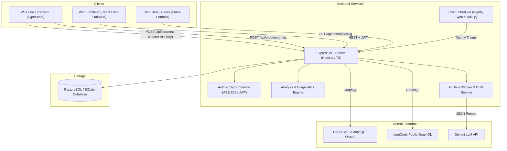
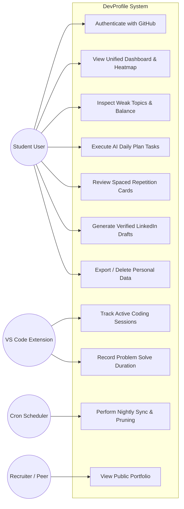
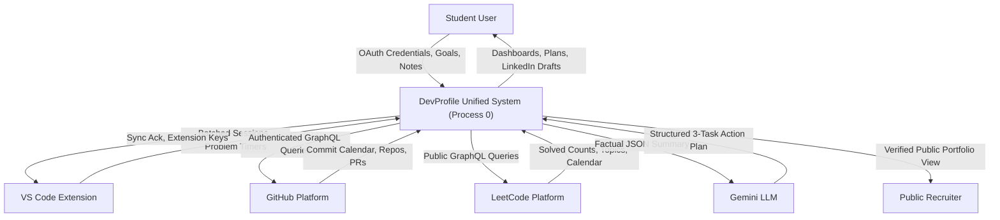
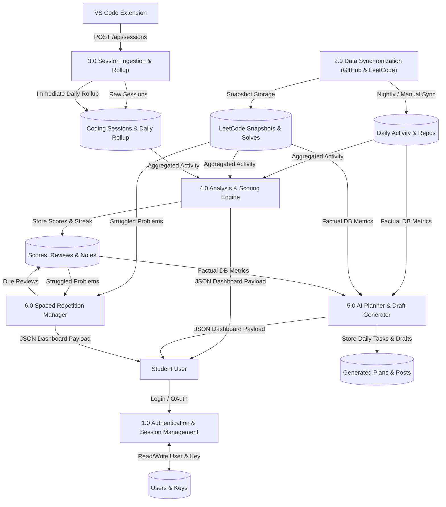
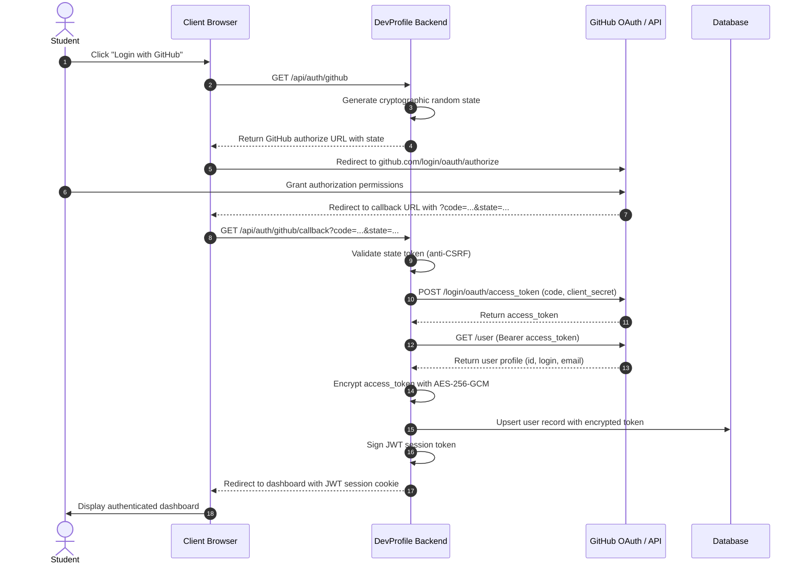
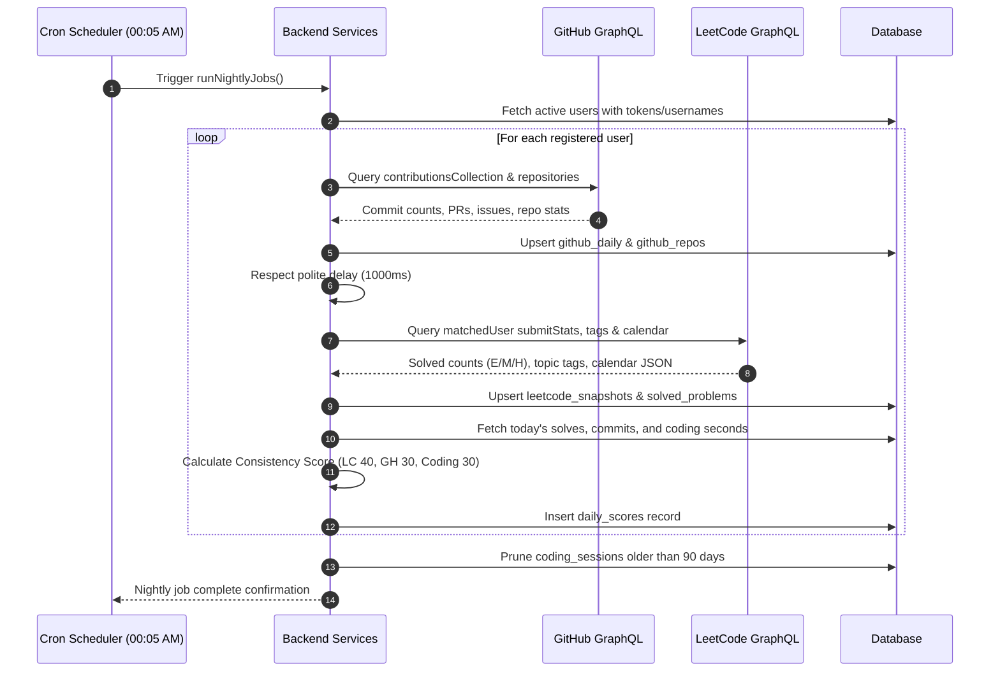
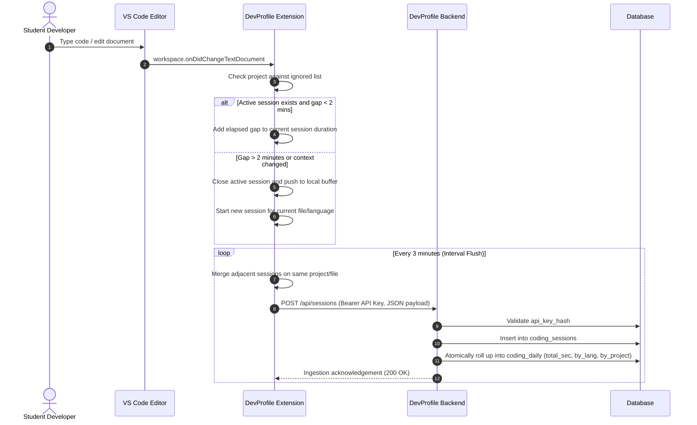
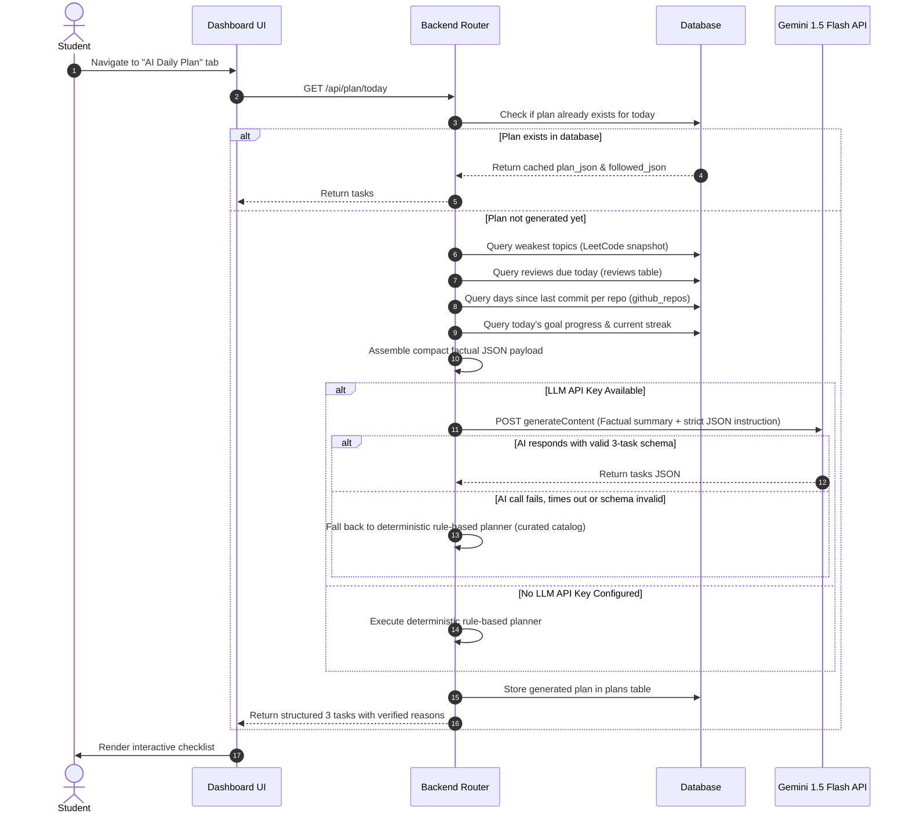
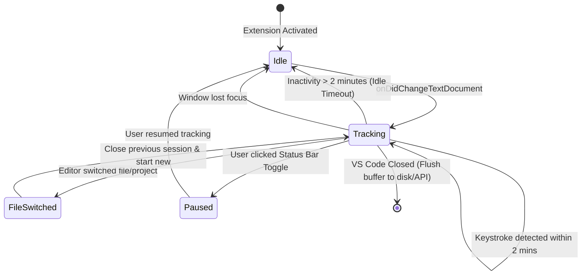

# System Design Document (SDD)
## Project: DevProfile — Unified Developer Analytics Platform
**Document Version:** 1.0  
**Authors:** Niharika Porwal, Shruti Sunil Choudhary, Somya Gupta  
**Department:** Computer Science & Engineering, Medi-Caps University, Indore  
**Guide:** Prof. Shraddha Kumar  

---

## 1. System Architecture Overview

DevProfile utilizes a modular, decoupled architecture consisting of a client dashboard, background editor daemon, central REST API, asynchronous cron worker, and persistent relational storage.

---

## 2. Use-Case Model

---

## 3. Data-Flow Diagrams (DFD)

### 3.1 Level 0 DFD (Context Diagram)

### 3.2 Level 1 DFD (Decomposed System Architecture)

---

## 4. Sequence Diagrams

### 4.1 GitHub OAuth Authentication Flow

### 4.2 Nightly Synchronization & Consistency Score Flow

### 4.3 VS Code Session Tracking & Idle Timeout Flow

### 4.4 AI Daily Planner Generation Flow

---

## 5. Extension Activity State Diagram

