# Database Design Document
## Project: DevProfile — Unified Developer Analytics Platform
**Document Version:** 1.0  
**Authors:** Niharika Porwal, Shruti Sunil Choudhary, Somya Gupta  
**Department:** Computer Science & Engineering, Medi-Caps University, Indore  
**Guide:** Prof. Shraddha Kumar  

---

## 1. Entity-Relationship (ER) Diagram

```mermaid
erDiagram
    USERS ||--o{ GITHUB_DAILY : logs
    USERS ||--o{ GITHUB_REPOS : owns
    USERS ||--o{ LEETCODE_SNAPSHOTS : captures
    USERS ||--o{ LEETCODE_SOLVED_PROBLEMS : solves
    USERS ||--o{ CODING_SESSIONS : tracks
    USERS ||--o{ CODING_DAILY : aggregates
    USERS ||--o{ PROBLEM_TIMES : records
    USERS ||--o{ REVIEWS : schedules
    USERS ||--o{ GOALS : configures
    USERS ||--o{ DAILY_SCORES : calculates
    USERS ||--o{ PROBLEM_NOTES : annotates
    USERS ||--o{ GENERATED_POSTS : generates
    USERS ||--o{ PLANS : assigns
    USERS ||--o{ SYNC_LOGS : records

    USERS {
        string id PK "UUID"
        string name "Full Name"
        string email "Unique Email"
        string github_id "GitHub Account ID"
        string github_username "GitHub Handle"
        string github_token_enc "AES-256 Encrypted OAuth Token"
        string leetcode_username "LeetCode Handle"
        string linkedin_sub "LinkedIn Sub / Identity"
        string api_key_hash "SHA-256 Personal Extension Key"
        string public_slug "Unique URL Slug"
        integer is_public "Portfolio Visibility (0/1)"
        string timezone "User Timezone"
        timestamp created_at "Registration Timestamp"
    }

    GITHUB_DAILY {
        string id PK "UUID"
        string user_id FK "References USERS(id)"
        string date "YYYY-MM-DD"
        integer commits "Daily Commit Count"
        integer prs "Daily Pull Requests"
        integer issues "Daily Issues Logged"
        integer repos_touched "Active Repositories"
        timestamp created_at
    }

    GITHUB_REPOS {
        string id PK "UUID"
        string user_id FK "References USERS(id)"
        string repo_name "Repository Name"
        string url "GitHub Repo URL"
        string primary_language "Main Language"
        string languages_json "JSON Array of Languages"
        integer stars "Stargazer Count"
        timestamp pushed_at "Last Git Push"
        timestamp created_at
    }

    LEETCODE_SNAPSHOTS {
        string id PK "UUID"
        string user_id FK "References USERS(id)"
        string date "YYYY-MM-DD"
        integer easy "Easy Solved Count"
        integer medium "Medium Solved Count"
        integer hard "Hard Solved Count"
        string topic_counts_json "JSON Topic Breakdown"
        string calendar_json "JSON Submission Calendar"
        string sync_status "success | failed"
        timestamp created_at
    }

    LEETCODE_SOLVED_PROBLEMS {
        string id PK "UUID"
        string user_id FK "References USERS(id)"
        string slug "Problem Slug"
        string title "Problem Title"
        string difficulty "Easy | Medium | Hard"
        string topic_tags "JSON Array of Tags"
        timestamp solved_at "Accepted Timestamp"
        integer struggled "Struggled Flag (0/1)"
        timestamp created_at
    }

    CODING_SESSIONS {
        string id PK "UUID"
        string user_id FK "References USERS(id)"
        string project "Workspace Name"
        string repo_url "Remote Git URL"
        string language "Language ID"
        string file "Relative File or Extension"
        timestamp start_time "Session Start ISO"
        integer duration_sec "Duration in Seconds"
        timestamp created_at
    }

    CODING_DAILY {
        string id PK "UUID"
        string user_id FK "References USERS(id)"
        string date "YYYY-MM-DD"
        integer total_sec "Total Seconds Coded"
        string by_language_json "JSON Breakdown by Language"
        string by_project_json "JSON Breakdown by Project"
        timestamp created_at
    }

    PROBLEM_TIMES {
        string id PK "UUID"
        string user_id FK "References USERS(id)"
        string problem_slug "Problem Slug"
        integer duration_sec "Solve Duration in Seconds"
        string felt_difficulty "Easy | Medium | Hard | Struggled"
        timestamp created_at
    }

    REVIEWS {
        string id PK "UUID"
        string user_id FK "References USERS(id)"
        string problem_slug "Problem Slug"
        string due_date "YYYY-MM-DD"
        integer interval_days "Interval (3, 7, 21)"
        timestamp done_at "Completion Timestamp"
        timestamp created_at
    }

    GOALS {
        string id PK "UUID"
        string user_id FK "References USERS(id)"
        string type "daily_leetcode | daily_commits | daily_coding_min"
        real target_value "Target Number"
        string period "daily | weekly"
        timestamp created_at
    }

    DAILY_SCORES {
        string id PK "UUID"
        string user_id FK "References USERS(id)"
        string date "YYYY-MM-DD"
        real consistency_score "0 to 100"
        real leetcode_pts "0 to 40"
        real github_pts "0 to 30"
        real coding_pts "0 to 30"
        timestamp created_at
    }

    PROBLEM_NOTES {
        string id PK "UUID"
        string user_id FK "References USERS(id)"
        string problem_slug "Problem Slug"
        string note_text "Personal Markdown Notes"
        string pattern_tag "Algorithmic Pattern Tag"
        timestamp updated_at
        timestamp created_at
    }

    GENERATED_POSTS {
        string id PK "UUID"
        string user_id FK "References USERS(id)"
        string type "weekly | project | profile"
        string text "Generated Post Body"
        integer posted "Marked Posted (0/1)"
        timestamp created_at
    }

    PLANS {
        string id PK "UUID"
        string user_id FK "References USERS(id)"
        string date "YYYY-MM-DD"
        string plan_json "JSON Array of 3 Tasks"
        string followed_json "JSON Array of Completed Task Indices"
        timestamp created_at
    }

    SYNC_LOGS {
        string id PK "UUID"
        string user_id FK "References USERS(id)"
        string source "github | leetcode"
        string status "success | failed"
        string error "Error Description"
        timestamp run_at
        timestamp created_at
    }
```

---

## 2. Table Specifications & Schema Definitions

### 2.1 Table: `users`
| Column | Type | Nullable | Constraints | Description |
|---|---|---|---|---|
| `id` | TEXT | NO | PRIMARY KEY | Unique UUID identifier |
| `name` | TEXT | NO | — | User's full display name |
| `email` | TEXT | YES | UNIQUE | Contact email address |
| `github_id` | TEXT | YES | UNIQUE | GitHub account ID from OAuth |
| `github_username` | TEXT | YES | — | GitHub handle |
| `github_token_enc` | TEXT | YES | — | AES-256-GCM encrypted access token |
| `leetcode_username` | TEXT | YES | — | Connected LeetCode handle |
| `linkedin_sub` | TEXT | YES | — | LinkedIn OpenID sub |
| `api_key_hash` | TEXT | YES | UNIQUE | SHA-256 hash of extension personal key |
| `public_slug` | TEXT | YES | UNIQUE | URL path slug for public portfolio |
| `is_public` | INTEGER | NO | DEFAULT 1 | 1 = Publicly viewable, 0 = Private |
| `timezone` | TEXT | NO | DEFAULT 'Asia/Kolkata' | User local timezone |
| `created_at` | TEXT | NO | DEFAULT datetime('now') | ISO creation timestamp |

### 2.2 Table: `github_daily`
| Column | Type | Nullable | Constraints | Description |
|---|---|---|---|---|
| `id` | TEXT | NO | PRIMARY KEY | Unique UUID identifier |
| `user_id` | TEXT | NO | FOREIGN KEY &rarr; users(id) | Associated user |
| `date` | TEXT | NO | UNIQUE(user_id, date) | Calendar date (`YYYY-MM-DD`) |
| `commits` | INTEGER | NO | DEFAULT 0 | Total commits pushed |
| `prs` | INTEGER | NO | DEFAULT 0 | Pull requests contributed |
| `issues` | INTEGER | NO | DEFAULT 0 | Issues opened |
| `repos_touched` | INTEGER | NO | DEFAULT 0 | Number of distinct repos active |
| `created_at` | TEXT | NO | DEFAULT datetime('now') | Record insertion timestamp |

**Indexes:** `CREATE INDEX idx_github_daily_user_date ON github_daily(user_id, date);`

### 2.3 Table: `github_repos`
| Column | Type | Nullable | Constraints | Description |
|---|---|---|---|---|
| `id` | TEXT | NO | PRIMARY KEY | Unique UUID identifier |
| `user_id` | TEXT | NO | FOREIGN KEY &rarr; users(id) | Associated user |
| `repo_name` | TEXT | NO | UNIQUE(user_id, repo_name) | Repository name |
| `url` | TEXT | NO | — | HTTPS repository link |
| `primary_language`| TEXT | YES | — | Primary detected language |
| `languages_json` | TEXT | NO | DEFAULT '{}' | JSON string of language breakdown |
| `stars` | INTEGER | NO | DEFAULT 0 | GitHub stargazers count |
| `pushed_at` | TEXT | YES | — | ISO timestamp of last commit push |
| `created_at` | TEXT | NO | DEFAULT datetime('now') | Insertion timestamp |

**Indexes:** `CREATE INDEX idx_github_repos_user ON github_repos(user_id);`

### 2.4 Table: `leetcode_snapshots`
| Column | Type | Nullable | Constraints | Description |
|---|---|---|---|---|
| `id` | TEXT | NO | PRIMARY KEY | Unique UUID identifier |
| `user_id` | TEXT | NO | FOREIGN KEY &rarr; users(id) | Associated user |
| `date` | TEXT | NO | UNIQUE(user_id, date) | Snapshot date (`YYYY-MM-DD`) |
| `easy` | INTEGER | NO | DEFAULT 0 | Easy problems solved count |
| `medium` | INTEGER | NO | DEFAULT 0 | Medium problems solved count |
| `hard` | INTEGER | NO | DEFAULT 0 | Hard problems solved count |
| `topic_counts_json`| TEXT | NO | DEFAULT '{}' | Topic counts and difficulty distribution |
| `calendar_json` | TEXT | NO | DEFAULT '{}' | Raw timestamp map from LeetCode |
| `sync_status` | TEXT | NO | DEFAULT 'success' | `success` or `failed` |
| `created_at` | TEXT | NO | DEFAULT datetime('now') | Snapshot capture timestamp |

**Indexes:** `CREATE INDEX idx_leetcode_snapshots_user_date ON leetcode_snapshots(user_id, date);`

### 2.5 Table: `leetcode_solved_problems`
| Column | Type | Nullable | Constraints | Description |
|---|---|---|---|---|
| `id` | TEXT | NO | PRIMARY KEY | Unique UUID identifier |
| `user_id` | TEXT | NO | FOREIGN KEY &rarr; users(id) | Associated user |
| `slug` | TEXT | NO | UNIQUE(user_id, slug) | Problem URL slug |
| `title` | TEXT | NO | — | Problem title |
| `difficulty` | TEXT | NO | — | `Easy`, `Medium`, or `Hard` |
| `topic_tags` | TEXT | NO | DEFAULT '[]' | JSON list of categories |
| `solved_at` | TEXT | NO | — | ISO timestamp when accepted |
| `struggled` | INTEGER | NO | DEFAULT 0 | Flag indicating difficulty / struggle |
| `created_at` | TEXT | NO | DEFAULT datetime('now') | Record insertion timestamp |

**Indexes:** `CREATE INDEX idx_leetcode_solved_user ON leetcode_solved_problems(user_id);`

### 2.6 Table: `coding_sessions`
| Column | Type | Nullable | Constraints | Description |
|---|---|---|---|---|
| `id` | TEXT | NO | PRIMARY KEY | Unique UUID identifier |
| `user_id` | TEXT | NO | FOREIGN KEY &rarr; users(id) | Associated user |
| `project` | TEXT | NO | — | Workspace root folder |
| `repo_url` | TEXT | YES | — | Git remote origin |
| `language` | TEXT | NO | — | VS Code language ID |
| `file` | TEXT | YES | — | Anonymized extension or relative path |
| `start_time` | TEXT | NO | — | Start ISO timestamp |
| `duration_sec` | INTEGER | NO | — | Duration in seconds |
| `created_at` | TEXT | NO | DEFAULT datetime('now') | Insertion timestamp |

**Retention Policy:** Pruned after 90 days. Raw sessions are rolled up immediately upon arrival into `coding_daily`.

### 2.7 Table: `coding_daily`
| Column | Type | Nullable | Constraints | Description |
|---|---|---|---|---|
| `id` | TEXT | NO | PRIMARY KEY | Unique UUID identifier |
| `user_id` | TEXT | NO | FOREIGN KEY &rarr; users(id) | Associated user |
| `date` | TEXT | NO | UNIQUE(user_id, date) | Calendar date (`YYYY-MM-DD`) |
| `total_sec` | INTEGER | NO | DEFAULT 0 | Total active coding seconds |
| `by_language_json` | TEXT | NO | DEFAULT '{}' | Language-wise seconds breakdown |
| `by_project_json` | TEXT | NO | DEFAULT '{}' | Project-wise seconds breakdown |
| `created_at` | TEXT | NO | DEFAULT datetime('now') | Insertion timestamp |

**Indexes:** `CREATE INDEX idx_coding_daily_user_date ON coding_daily(user_id, date);`

### 2.8 Table: `reviews` (Spaced Repetition Queue)
| Column | Type | Nullable | Constraints | Description |
|---|---|---|---|---|
| `id` | TEXT | NO | PRIMARY KEY | Unique UUID identifier |
| `user_id` | TEXT | NO | FOREIGN KEY &rarr; users(id) | Associated user |
| `problem_slug` | TEXT | NO | — | Slug of problem to review |
| `due_date` | TEXT | NO | — | Due date (`YYYY-MM-DD`) |
| `interval_days` | INTEGER | NO | DEFAULT 3 | Current interval (3, 7, 21) |
| `done_at` | TEXT | YES | — | Completion timestamp |
| `created_at` | TEXT | NO | DEFAULT datetime('now') | Creation timestamp |

**Indexes:** `CREATE INDEX idx_reviews_user_due ON reviews(user_id, due_date);`

---

## 3. Data Retention and Size Estimation (Section 5.1)

### 3.1 Design Rules to Keep the Database Small
1. **Snapshots, Not Full Responses:** DevProfile stores structured summaries (e.g. Easy/Medium/Hard counts, topic summaries) rather than dumping raw external API JSON payloads.
2. **Rolling Ingestion:** High-frequency `coding_sessions` are retained for 90 days to generate hourly heatmaps, then pruned once rolled into `coding_daily`.
3. **No Heartbeat Polling:** The VS Code extension does not ping every 2 seconds. Instead, it maintains a local buffer and transmits an aggregated batch every 3 minutes.

### 3.2 Quantitative Storage Calculations
- **Users Table:** 1 row per user $\approx 500$ bytes.
- **GitHub Daily:** 365 rows per user/year $\times 80$ bytes $\approx 29.2$ KB.
- **LeetCode Snapshots:** 365 rows per user/year $\times 350$ bytes $\approx 127.7$ KB.
- **Coding Daily:** 365 rows per user/year $\times 200$ bytes $\approx 73.0$ KB.
- **Coding Sessions (90-day window):** 10 sessions/day $\times 90 \times 120$ bytes $\approx 108$ KB.
- **Daily Scores & Reviews:** 365 rows $\times 60$ bytes $\approx 21.9$ KB.
- **Generated Posts, Plans & Notes:** $\approx 150$ KB.

$$\text{Total Storage per User per Year} \approx 1.5 - 2.0\text{ MB}$$

For a pilot deployment of **1,000 active students**, total yearly database consumption is approximately **2 GB**, fitting comfortably within the free tier limits of Supabase or Railway PostgreSQL.
