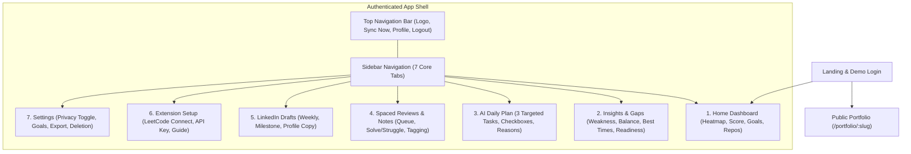

# User Interface Design & Navigation Specification
## Project: DevProfile — Unified Developer Analytics Platform
**Document Version:** 1.0  
**Authors:** Niharika Porwal, Shruti Sunil Choudhary, Somya Gupta  
**Department:** Computer Science & Engineering, Medi-Caps University, Indore  
**Guide:** Prof. Shraddha Kumar  

---

## 1. Visual Design System

### 1.1 Color Palette
- **Primary Background:** `#0B0F19` (Deep Charcoal Navy)
- **Card Background:** `#111827` (Tailwind Gray-900)
- **Border Trim:** `#1F2937` (Tailwind Gray-800)
- **Primary Brand Accent:** `#6366F1` (Indigo-500)
- **Success / Heatmap Peak:** `#10B981` (Emerald-500)
- **Streak & Fire Accent:** `#F97316` (Orange-500)
- **Warning & Focus Accent:** `#F59E0B` (Amber-500)

### 1.2 Typography
- **Primary Heading & UI Font:** `Plus Jakarta Sans`, sans-serif (Weights: 400, 600, 700, 800)
- **Code & Numeric Font:** `JetBrains Mono`, monospace

---

## 2. Navigation Architecture & Screen Hierarchy



---

## 3. Screen Wireframes & Layout Descriptions

### 3.1 Screen 1: Home Dashboard
```
+-----------------------------------------------------------------------------------------+
| [DP] DevProfile   (🔥 12d Streak)   [Sync Now]   [Public Portfolio ↗]   (User Avatar)   |
+-------------------+---------------------------------------------------------------------+
| [Dashboard]       | +-----------------------------------------------+ +---------------+ |
| [Insights & Gaps] | | 🔥 12 Days Active Streak                      | | Daily Score   | |
| [AI Daily Plan]   | | Weekly Avg: 88/100 • 1 Freeze Day Available   | |    ( 88% )    | |
| [Spaced Reviews]  | +-----------------------------------------------+ | LC: 40/40     | |
| [LinkedIn Drafts] | | [LC Goal: 2/2] | [Commits: 4/3] | [IDE: 85m/60m]| | GH: 30/30     | |
| [Extension Setup] | +-----------------------------------------------+ | IDE: 18/30    | |
| [Settings]        |                                                   +---------------+ |
|                   | +-----------------------------------------------------------------+ |
|                   | | Merged Heatmap (GitHub + LeetCode + VS Code Matrix)   [30D Window]| |
|                   | | ■ ■ ■ ■ ■ ■ ■ ■ ■ ■ ■ ■ ■ ■ ■ ■ ■ ■ ■ ■ ■ ■ ■ ■ ■ ■ ■ ■ ■ ■     | |
|                   | +-----------------------------------------------------------------+ |
|                   | +-------------------------------+ +-------------------------------+ |
|                   | | Active Repositories (5)       | | Recent Algorithmic Solves     | |
|                   | | • devprofile (TypeScript) ★28 | | • Coin Change (Med) [Struggled] | |
|                   | | • algo-visualizer (React) ★19 | | • Course Schedule (Med)       | |
|                   | +-------------------------------+ +-------------------------------+ |
+-------------------+---------------------------------------------------------------------+
```

### 3.2 Screen 2: Insights & Gap Diagnostics
- **Balance Detector Banner:** Top card dynamically displaying the 14-day rolling delta between practice solves and build commits.
- **Weakness Analyzer Grid:** Ranked bar cards displaying topic volume vs. average, plus medium/hard depth ratio.
- **Interview Readiness Pillar Breakdown:** 4-quadrant visual breakdown for Difficulty Mix, Topic Breadth, Consistency, and Project Cadence.
- **Skill-Gap Map:** Two-sided cards contrasting DSA mastery against real repository implementations.
- **Best-Time Heat Matrix:** Hour-by-hour and day-of-week productivity peaks in the student's local timezone.

### 3.3 Screen 3: AI Daily Plan
- **Summary Header:** Completed tasks counter ($X$ of 3 finished) with a progress bar.
- **3 Task Cards:**
  1. **Practice Task:** e.g., "Solve Coin Change (Medium)" with explicit reason: "Dynamic Programming is your most under-practiced topic."
  2. **Project Task:** e.g., "Ship a commit to devprofile" with reason: "No commits recorded in 6 days."
  3. **Review Task:** e.g., "Redo Course Schedule" with reason: "Scheduled 3-day spaced repetition interval reached."
- **Interactive Checkboxes:** Instantly persists progress to `plans.followed_json`.

### 3.4 Screen 4: Spaced Repetition Queue & Notes
- **Active Queue:** Problem cards due today with solve duration, pattern tag, and personal notes.
- **Action Buttons:** "Solved" (advances to next interval) vs. "Struggled" (resets to 3-day checkpoint).
- **Pattern Note Scratchpad:** In-app markdown editor allowing students to record key insights (e.g., state transitions, cycle detection).

### 3.5 Screen 5: LinkedIn Draft Generator
- **Category Tabs:** Weekly Progress, Project Milestone, and Profile Checklist.
- **Anti-Fabrication Notice:** Clear banner assuring zero inflated numbers.
- **Action Bar:** 1-Click Copy-to-Clipboard, "Mark as Posted" state toggle, direct LinkedIn feed shortcut.

### 3.6 Screen 6: Public Portfolio (`/portfolio/:slug`)
- Accessible to recruiters and classmates without authentication.
- Displays verified LeetCode solves (by difficulty), GitHub repositories, total coding hours, and an authentic "Verified by DevProfile" credibility badge.
