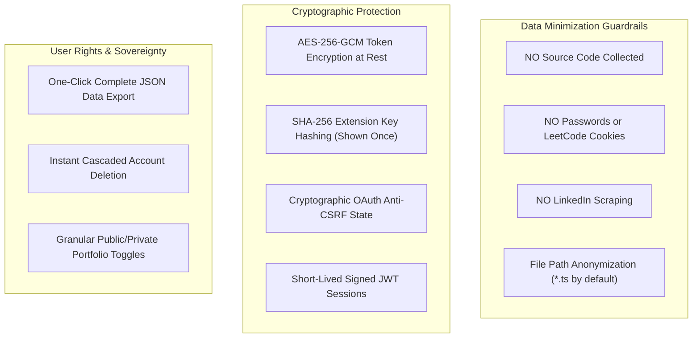

# Security and Privacy Specification
## Project: DevProfile — Unified Developer Analytics Platform
**Document Version:** 1.0  
**Authors:** Niharika Porwal, Shruti Sunil Choudhary, Somya Gupta  
**Department:** Computer Science & Engineering, Medi-Caps University, Indore  
**Guide:** Prof. Shraddha Kumar  

---

## 1. Security Architecture Principles

DevProfile follows a **Privacy-First, Data Minimization** engineering architecture. We prioritize the student's intellectual property, personal credentials, and compliance with external platform Terms of Service.



---

## 2. Secrets & Credentials Management (Section 9)

### 2.1 Storage & Environment Variables
- All third-party OAuth client secrets (`GITHUB_CLIENT_SECRET`), JWT signing keys (`JWT_SECRET`), AES master encryption keys (`TOKEN_ENCRYPTION_KEY`), and LLM API keys (`GEMINI_API_KEY`) reside exclusively within environment variables.
- `.env` is committed to `.gitignore` and strictly forbidden from version control.

### 2.2 Token Encryption at Rest
All external OAuth access tokens are encrypted in the database using **AES-256-GCM** (Galois/Counter Mode).
- **IV (Initialization Vector):** 12 bytes randomly generated per encryption operation.
- **Auth Tag:** 16 bytes for cryptographic integrity verification.
- **Format Stored:** `iv_hex:tag_hex:ciphertext_hex`

### 2.3 VS Code Extension Personal API Keys
- Personal API keys use the prefix `devprof_` followed by 48 random hex characters.
- When generated, the plaintext key is returned **only once** to the user in the onboarding or settings modal.
- The backend stores exclusively the SHA-256 hash (`users.api_key_hash`), preventing token exposure in the event of database backups inspection.

---

## 3. Data Minimization & Privacy Filters

### 3.1 Source Code Protection
The VS Code extension tracks editor focus, typing duration, language ID, and active project name. **Source code content, variable names, and file contents are never read, buffered, or transmitted.**

### 3.2 File Path Anonymization
By default, the extension setting `devprofile.trackFileNames` is set to `false`. Instead of logging full file paths, the extension records only the extension (e.g. `*.ts`, `*.py`). Students may selectively enable file name logging if desired.

### 3.3 Platform Terms of Service Compliance
- **LeetCode:** We do not request session cookies (`LEETCODE_SESSION`) or attempt to scrape private submission source code.
- **LinkedIn:** We do not automate user interactions or scrape profile feeds. Output is generated as formatted markdown text for manual user review and posting.

---

## 4. User Rights & Data Sovereignty

### 4.1 Right to Data Portability (Full Export)
Under `GET /api/export`, any authenticated user can download an exact JSON archive of every single record stored across all 15 database tables.

### 4.2 Right to Erasure (Account Deletion)
Under `DELETE /api/account`, the system performs an immediate atomic SQL deletion:
```sql
DELETE FROM users WHERE id = ?;
```
Because all secondary tables define foreign keys with `ON DELETE CASCADE`, all daily scores, coding sessions, LeetCode snapshots, reviews, notes, and generated drafts are permanently purged from the database.
